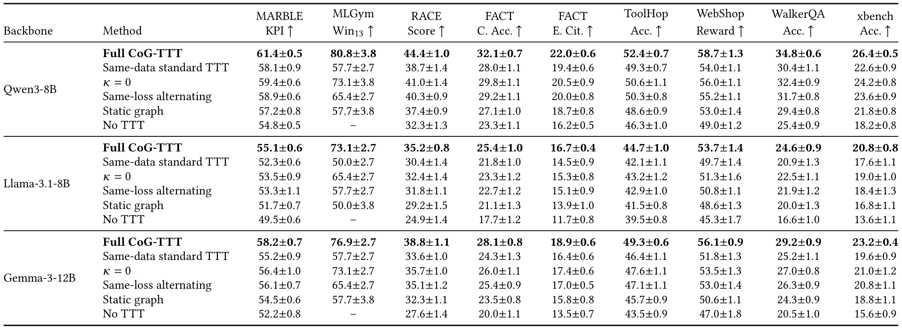
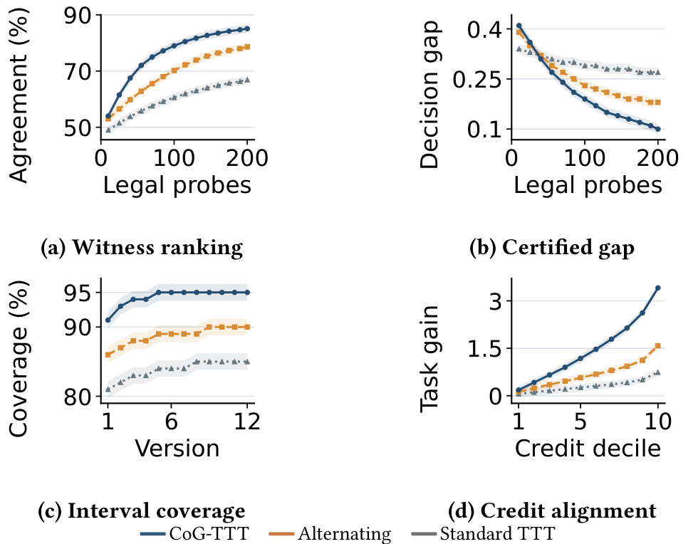

# CoG-TTT: Joint Test-Time Training for Evolving Agentic Graphs

Long-horizon Web research agents coordinate search, evidence verification, and
tool use through evolving collaboration graphs. Their executions provide
feedback for test-time training (TTT), yet unreliable training signals and
uncertain downstream gains make node-level adaptation challenging. In
particular, the value of a parameter update depends on how downstream nodes use
its outputs, while improved node capabilities can reshape the optimal
collaboration graph. Existing TTT methods focus on model adaptation, yet provide
limited guidance for these coupled decisions. To address this challenge, we
propose CoG-TTT, a graph-coupled method that jointly optimizes node-level
training and evolving agentic graphs. Specifically, we compare feasible
execution continuations to construct confidence-aware training signals, perform
graph-conditioned parameter updates, and coordinate training and graph selection
through witness-guided optimization. We further derive conditional bounds on
joint decision quality and solve a graph-bound allocation subproblem exactly
using dynamic programming, providing theoretical guidance for resource
allocation. We evaluate CoG-TTT on seven public benchmarks using Qwen3-8B,
Llama-3.1-8B-Instruct, and Gemma-3-12B-it. Across all three backbones, CoG-TTT
improves over the strongest baseline for each of the eight native metrics by
4.87 on average. It also improves upon matched alternating optimization across
the three backbones and reduces legal-probe costs by 52% at matched decision
quality.

## Algorithm Flow

To couple node adaptation with executable graph evolution, we optimize their shared downstream utility.


**Figure 1.** Graph-coupled adaptation during Web misinformation research, illustrated with a DeepResearch Bench question on need for closure and misinformation acceptance. Citation tracing supplies evidence for downstream analysis. Paired continuations guide node training, while joint selection updates the execution graph for subsequent research stages.


## Results

### Main Results

**Table 1.** Results on seven complete public benchmarks. Cells show five-seed mean ± sample standard deviation. Bold marks the best mean within each backbone. Win13 compares MLGym outcomes with No TTT; all columns favor higher values.


### Ablation Study

**Table 2.** Component ablations across three backbones. Metrics and uncertainty follow Table 1. Each variant changes the specified training or graph mechanism; No TTT provides the Win13 reference.



**Joint selection improves upon alternating optimization.** Using the same loss and feasible family, CoG-TTT improves the eight-metric average by 2.9 on Qwen3-8B, 2.6 on Gemma, and 2.4 on Llama. Joint validation can select an update whose benefit emerges in a different future graph, which helps explain the remaining advantage over sequential training and graph selection.

### Analysis



**Figure 2.** Qwen3-8B diagnostics of witness ranking, decision gaps, interval coverage, and credit-decile gain. Curves show five-seed means; bands show one sample standard deviation.

**Reliable credit tracks downstream benefit.** Figure 2c reports final interval coverage of 95.0%, 90.0%, and 85.0% for the three methods, respectively. CoG-TTT reaches the nominal 95% level under the stated certificate conditions. Figure 2d orders records by interaction credit. Its highest decile yields a gain of 3.41, compared with 0.18 in the lowest decile, with Spearman correlation 0.91. This alignment supports prioritizing records whose estimated effects survive subsequent execution.

## Getting Started

### Environment Setup

```bash
conda create -n cog-ttt python=3.10 -y
conda activate cog-ttt
pip install -e '.[models]'
```

### Data Preparation

The run command reads `task.json`, which specifies the task, model, environment,
initial graph, and calibration inputs. The [task format](docs/environment.md)
describes these inputs.

## Training

Run joint optimization. The command collects the configured calibration
measurements before search:

```bash
python -m cog_ttt run --case task.json --config configs/paper.yaml \
  --output results/task
```

## Evaluation

Evaluate the final execution and summarize the scores:

```bash
python -m cog_ttt evaluate --case task.json --run results/task \
  --backbone qwen --output results/final.jsonl

python -m cog_ttt summarize --records results/final.jsonl \
  --output results/summary.json
```

## License

[MIT License](LICENSE).
