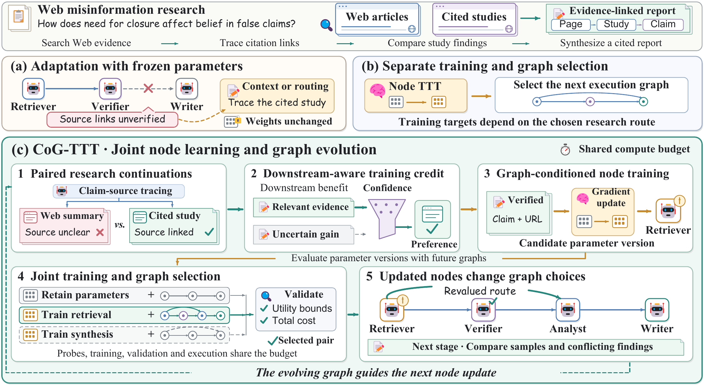

# CoG-TTT

Code for **CoG-TTT: Joint Test-Time Training for Evolving Agentic Graphs**.

CoG-TTT jointly optimizes node-level training and evolving agentic graphs under a shared compute budget. Feasible continuation comparisons provide confidence-aware training signals for graph-conditioned parameter updates.



## Installation

Python 3.10 or later.

```bash
python3 -m venv .venv
source .venv/bin/activate
python -m pip install -i https://pypi.tuna.tsinghua.edu.cn/simple -e ".[models,test]"
export HF_ENDPOINT=https://hf-mirror.com
```

## Usage

Validate and run the included protocol example.

```bash
python -m cog_ttt check --case examples/protocol_check.json
python -m cog_ttt run --case examples/protocol_check.json --output results/protocol-check
```

Configure native benchmark tasks through the [environment interface](docs/environment.md). For a configured `task.json`, run

```bash
python -m cog_ttt run --case task.json --output results/task
python -m cog_ttt evaluate --case task.json --run results/task --backbone qwen --output results/final.jsonl
python -m cog_ttt summarize --records results/final.jsonl --output results/summary.json
```

## Configuration

- [Paper settings](configs/paper.yaml) specify the loss, confidence, and budget parameters.
- [Backbone configuration](configs/backbones.yaml) lists the public model identifiers.
- [Benchmark configuration](configs/benchmarks.yaml) records the evaluation protocol and upstream resources.

## Tests

```bash
python -m pytest -q
```
