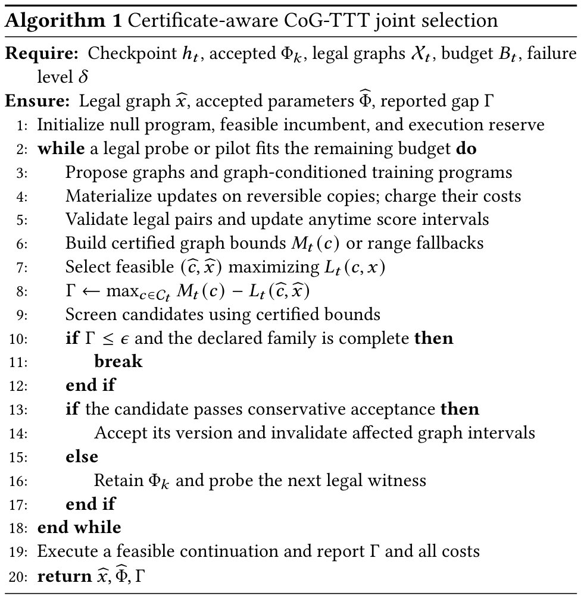
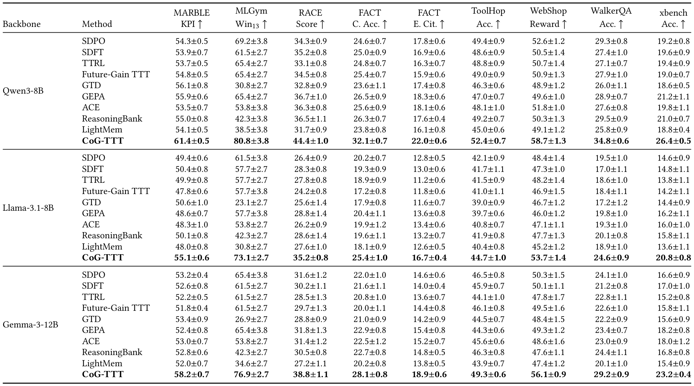

# CoG-TTT: Joint Test-Time Training for Evolving Agentic Graphs

Long-horizon Web research agents coordinate search, evidence verification, and
tool use through evolving collaboration graphs. Their executions provide
feedback for test-time training (TTT), yet unreliable training signals and
uncertain downstream gains make node-level adaptation challenging. In
particular, the value of a parameter update depends on how downstream nodes use
its outputs, while improved node capabilities can reshape the optimal
collaboration graph. Existing TTT methods focus on model adaptation, yet provide
limited guidance for these coupled decisions. To address this challenge, we
propose CoG-TTT, a graph-coupled method that jointly optimizes node-level
training and evolving agentic graphs. Specifically, we compare feasible
execution continuations to construct confidence-aware training signals, perform
graph-conditioned parameter updates, and coordinate training and graph selection
through witness-guided optimization. We further derive conditional bounds on
joint decision quality and solve a graph-bound allocation subproblem exactly
using dynamic programming, providing theoretical guidance for resource
allocation. We evaluate CoG-TTT on seven public benchmarks using Qwen3-8B,
Llama-3.1-8B-Instruct, and Gemma-3-12B-it. Across all three backbones, CoG-TTT
improves over the strongest baseline for each of the eight native metrics by
4.87 on average. It also improves upon matched alternating optimization across
the three backbones and reduces legal-probe costs by 52% at matched decision
quality.

## Algorithm Flow


**Figure 1.** Graph-coupled adaptation during Web misinformation research, illustrated with a DeepResearch Bench question on need for closure and misinformation acceptance. Citation tracing supplies evidence for downstream analysis. Paired continuations guide node training, while joint selection updates the execution graph for subsequent research stages.

To couple node adaptation with executable graph evolution, we optimize their
shared downstream utility. CoG-TTT first constructs legal graph-dependent
supervision, then proposes node updates, and finally selects parameter versions
and collaboration graphs using certified decision bounds.

1. **Graph-Coupled Test-Time Training Design.** To train nodes toward downstream
   task requirements, we compare two outputs of a trainable operation at the same
   legal checkpoint. Verified targets require a check by the environment's tool
   or execution interface; unverified records enter preference comparisons
   alone. Preference updates favor improved downstream continuations, while the
   verified term teaches observed tool requirements and KL regularization limits
   drift. The program is skipped when both sources vanish. The trained owner is
   stored as a reversible version.

2. **Certificate-Aware Joint Decision Design.** Large oracle slack triggers
   graph-oracle refinement; large interaction uncertainty motivates a legal
   comparison when its measured cost fits the protected reserve. The dynamic
   program solves its integer allocation exactly; cross-partition and
   local-profile relaxations account for its gap to the original graph problem.

3. **Training-Induced Graph Evolution.** Each accepted version renews intervals;
   tool nondeterminism or web drift creates a new task state, and coverage is
   reported per version. The next training program is therefore chosen using
   graph estimates associated with its actual candidate model version. Accepted
   updates initiate new versioned certification; a budget-limited run returns the
   feasible incumbent and its reported gap.



## Results

### Main Results

**Table 1.** Results on seven complete public benchmarks. Cells show five-seed mean ± sample standard deviation. Win13 compares MLGym outcomes with No TTT; all columns favor higher values.



**CoG-TTT improves performance across model families.** Across eight native metrics, the mean improvements over the strongest baseline in each column are 5.24 on Qwen3-8B, 4.50 on Llama, and 4.86 on Gemma. Their aggregate improvement of 4.87 supports the benefit of joint adaptation across backbone families.

**Web tasks benefit across research and interaction.** On Qwen3-8B, MARBLE KPI increases from 56.1 to 61.4 and RACE from 36.7 to 44.4. ToolHop accuracy rises from 49.4 to 52.4, with a paired 95% interval of [2.1, 3.9] for the gain; WebShop reward rises from 52.6 to 58.7, with an interval of [5.3, 6.9]. These tasks link intermediate evidence or actions to subsequent decisions. Their improvements are consistent with evaluating node updates through the continuations that use their outputs.

## Getting Started

### Environment Setup

```bash
conda env create -f environment.yml
conda activate cog-ttt
pip install -e '.[models]'
```

### Data Preparation

The experiments use [MARBLE](https://github.com/ulab-uiuc/MARBLE),
[MLGym-Bench](https://github.com/facebookresearch/MLGym),
[DeepResearch Bench](https://github.com/Ayanami0730/deep_research_bench),
[ToolHop](https://huggingface.co/datasets/bytedance-research/ToolHop),
[WebShop](https://github.com/princeton-nlp/WebShop),
[WebWalkerQA](https://github.com/Alibaba-NLP/DeepResearch/tree/main/WebAgent/WebWalker),
and [xbench-DeepSearch-2505](https://github.com/xbench-ai/xbench-evals).

Prepare `inputs/task.json` with the task, native environment, initial execution
graph, parameter owners, and calibration inputs. The
[task format](docs/environment.md#case-files) describes these inputs.

## Training

Select a backbone:

- **Qwen3-8B**: `MODEL=qwen`
- **Llama-3.1-8B-Instruct**: `MODEL=llama`
- **Gemma-3-12B-it**: `MODEL=gemma`

Run joint node training and graph optimization:

```bash
python -m cog_ttt run --case inputs/task.json --config configs/paper.yaml \
  --backbone "${MODEL}" --output "results/${MODEL}/task"
```

To resume an interrupted run, add `--resume` to the same command.

## Evaluation

Evaluate the completed task with its native evaluator:

```bash
python -m cog_ttt evaluate --run "results/${MODEL}/task" \
  --output "results/${MODEL}/scores.jsonl"
```

Aggregate the benchmark evaluations after completing all tasks and seeds:

```bash
python -m cog_ttt summarize --records "results/${MODEL}/scores.jsonl" \
  --output "results/${MODEL}/summary.json"
```

## License

[MIT License](LICENSE).
