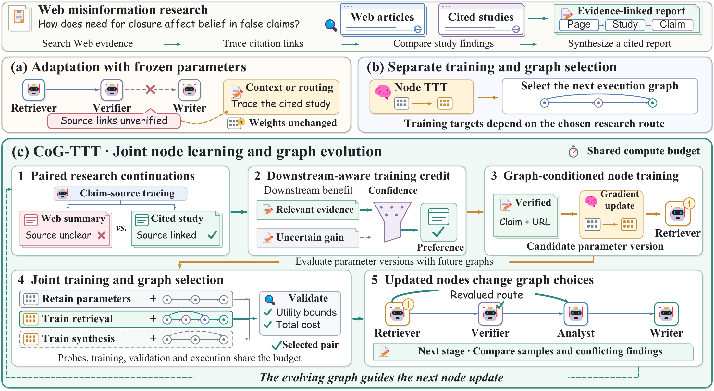

# CoG-TTT: Joint Test-Time Training for Evolving Agentic Graphs

Long-horizon Web research agents coordinate search, evidence verification, and
tool use through evolving collaboration graphs. Their executions provide
feedback for test-time training (TTT), yet unreliable training signals and
uncertain downstream gains make node-level adaptation challenging. In
particular, the value of a parameter update depends on how downstream nodes use
its outputs, while improved node capabilities can reshape the optimal
collaboration graph. Existing TTT methods focus on model adaptation, yet provide
limited guidance for these coupled decisions. To address this challenge, we
propose CoG-TTT, a graph-coupled method that jointly optimizes node-level
training and evolving agentic graphs. Specifically, we compare feasible
execution continuations to construct confidence-aware training signals, perform
graph-conditioned parameter updates, and coordinate training and graph selection
through witness-guided optimization. We further derive conditional bounds on
joint decision quality and solve a graph-bound allocation subproblem exactly
using dynamic programming, providing theoretical guidance for resource
allocation. We evaluate CoG-TTT on seven public benchmarks using Qwen3-8B,
Llama-3.1-8B-Instruct, and Gemma-3-12B-it. Across all three backbones, CoG-TTT
improves over the strongest baseline for each of the eight native metrics by
4.87 on average. It also improves upon matched alternating optimization across
the three backbones and reduces legal-probe costs by 52% at matched decision
quality.



## Installation

Use Python 3.10 or later and install PyTorch for your system.

```bash
python -m venv .venv
source .venv/bin/activate
python -m pip install -e '.[models]' \
  --index-url https://pypi.tuna.tsinghua.edu.cn/simple
export HF_ENDPOINT=https://hf-mirror.com
```

## Running on a benchmark

Prepare `task.json` with your model checkpoint, environment adapter, graph, and
calibration inputs. The [environment guide](docs/environment.md) describes the
case format and adapter interface. Model profiles and benchmark resources are in
[configs/](configs).

Start joint optimization:

```bash
python -m cog_ttt run --case task.json --config configs/paper.yaml \
  --output results/task
```

`run` collects the configured calibration measurements before search.

## Evaluation

Evaluate the final execution and summarize the scores:

```bash
python -m cog_ttt evaluate --case task.json --run results/task \
  --backbone qwen --output results/final.jsonl

python -m cog_ttt summarize --records results/final.jsonl \
  --output results/summary.json
```

## License

[MIT License](LICENSE).
